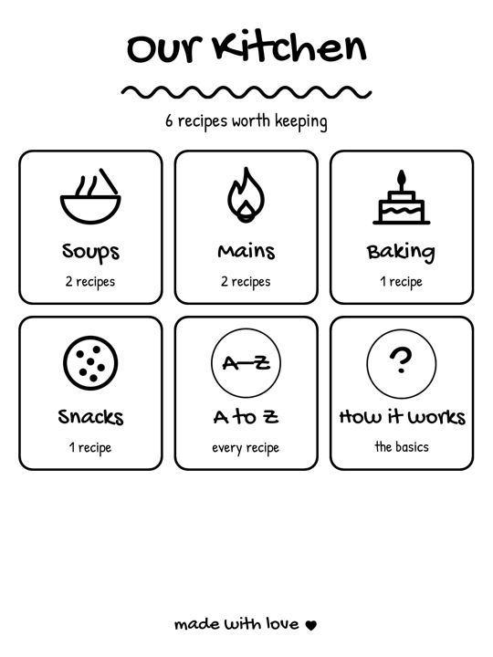
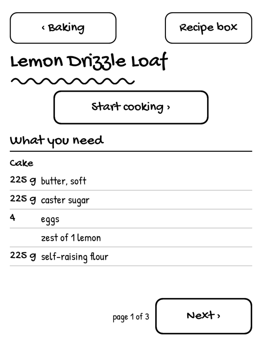
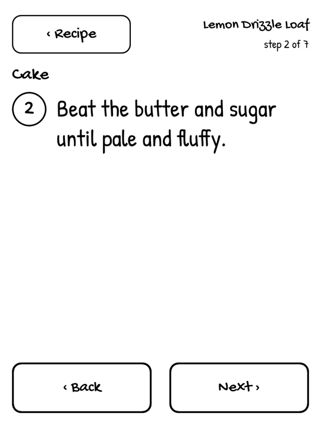
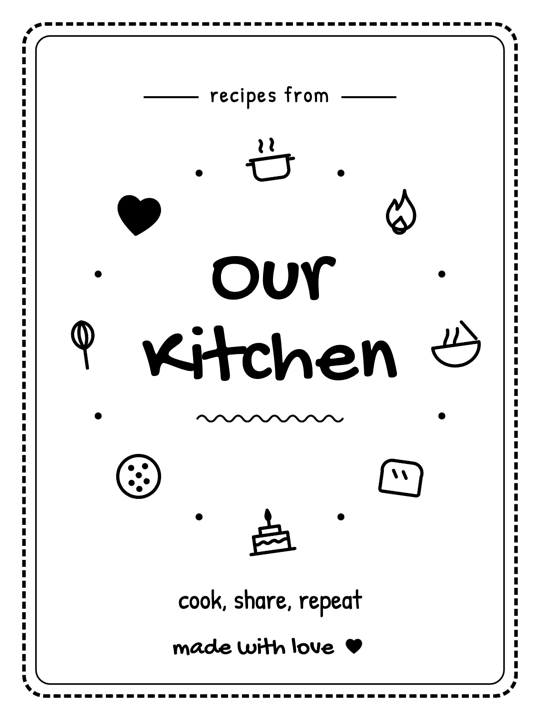

# Kobo Kitchen

Turn an old Kobo e-reader into a recipe box for the fridge door.

<p>




</p>

Kobo Kitchen is a [KOReader](https://koreader.rocks) plugin and a few tools for a Mac. Once it's
on, the Kobo opens straight into your recipe box:

- a big tile for each chapter, plus A to Z;
- the recipes in handwriting fonts, with the amounts in a column of their own;
- a cooking mode: one step per screen, in big writing, with big Back and Next buttons;
- the cookbook's cover as the sleep screen;
- nothing to get lost in: KOReader stays hidden underneath, and the Kobo only sleeps and wakes.
  A hidden menu (hold a finger on the big title) is for whoever looks after it.

The recipes live in one file on your computer (`recipes.js`) and go onto the Kobo by USB cable.
Getting new recipes over Wi-Fi, from a website of your own, is optional and off unless you turn
it on.

## Tested on

- **Kobo Aura HD** (2013), Kobo software **4.38.23684**
- **KOReader v2026.07.1** on the Kobo, started by **NickelMenu v0.6.0**
- An Apple Silicon Mac with Node.js 25. The Mac preview ran on a KOReader for macOS nightly
  (v2026.07.2-336-g4e973da).

Other Kobos on Kobo software 4.x will probably work: KOReader and NickelMenu run on most of them,
and the screens scale to any size. But nobody has tried, so the installer asks for `--any-kobo`
first. The tools are for macOS (they use its `ditto`, `diskutil` and `sips`).

## How it fits together

```
recipes.js + book.json
    │   (tools/kitchen-bundle.mjs)
    ▼
recipes.json + art/*.png + latest.json
    ├──► by cable, the default:  tools/kobo-install.mjs ──► the Kobo
    └──► optional, Wi-Fi:  tools/kitchen-publish.mjs ──► your website ──► "Get new recipes" on the Kobo
```

## What you need

- The Kobo and its USB cable, and a Mac.
- [Node.js](https://nodejs.org) 18 or newer (`node --version`). There's nothing to `npm install`:
  the tools only use what comes with Node.
- Google Chrome, only to redraw the cover (or the doodles).
- The Kobo set up already (past Kobo's welcome screens, showing My Books), with about 100 MB free.

## 1. Get the kit, KOReader and NickelMenu

```sh
git clone https://github.com/TechnoDudeX/kobokitchen.git
cd kobokitchen
mkdir -p .cache/koreader
curl -L -o .cache/koreader/koreader-kobo-v2026.07.1.zip \
  https://github.com/koreader/koreader/releases/download/v2026.07.1/koreader-kobo-v2026.07.1.zip
curl -L -o .cache/koreader/NickelMenu-v0.6.0-KoboRoot.tgz \
  https://github.com/pgaskin/NickelMenu/releases/download/v0.6.0/KoboRoot.tgz
shasum -a 256 .cache/koreader/*
```

The sums must be these (the installer checks them too, and won't go on with a file that differs):

| File | SHA-256 |
| --- | --- |
| `koreader-kobo-v2026.07.1.zip` | `0f36a62ce73b12516f969e4ad7862cc06920afb03c7bd4db29a0d990bdd84b2f` |
| `NickelMenu-v0.6.0-KoboRoot.tgz` | `322ff9aa863860e8f5f7e0b55cae561c54bf95983b9bce1d19819d1225d064af` |

They come from the [KOReader v2026.07.1](https://github.com/koreader/koreader/releases/tag/v2026.07.1)
and [NickelMenu v0.6.0](https://github.com/pgaskin/NickelMenu/releases/tag/v0.6.0) releases.

## 2. Make it yours

1. **`recipes.js`**: your recipes, in place of the six samples. How to write one is at the top of
   the file. Each recipe has a title, a chapter, and one or more parts, each with its
   ingredients and steps.
2. **`book.json`**: the title and the other words on the screens, and the chapters (see
   [book.json](#bookjson) below).
3. **The cover**, with your title on it:

   ```sh
   node tools/make-cover.mjs
   ```

4. **A look on the Mac** (optional, see [The Mac preview](#the-mac-preview)):

   ```sh
   node tools/kitchen-preview.mjs
   ```

   It saves a picture of every screen in `preview/`, at the Aura HD's size.

## 3. Put it on the Kobo, by cable

1. Charge the Kobo a little and wake it up.
2. Plug it into the Mac. On the Kobo, tap **Connect**. If it doesn't ask, see
   [If the Kobo only charges](#if-the-kobo-only-charges).
3. Wait until **KOBOeReader** shows up in Finder, then run:

   ```sh
   node tools/kobo-install.mjs
   ```

   (`node tools/kobo-install.mjs --dry-run` first shows what it would do, in a fake Kobo folder.)
4. When it says **Done!** and has ejected the Kobo, unplug it. The Kobo installs NickelMenu and
   restarts by itself. **If it doesn't restart** (the Aura HD didn't), switch it off and on
   again with its power switch. Wait for My Books.
5. Tap **Recipes** at the bottom right of My Books, then **Recipes** in the little menu.
   KOReader starts (slowly the first time) and opens your recipe box.

**Don't switch the Kobo off within 20 seconds of switching it on:** NickelMenu takes that as a
sign that it broke something, and uninstalls itself.

What the installer does, each part only when it's needed (so it's safe to run again):

1. Checks it's a Kobo Aura HD on Kobo software 4.x, and that the downloads are the right files.
   Keeps a copy of Kobo's settings and library on the Mac, in `.cache/kobo-backup/<date>`.
2. NickelMenu, the launcher: its installer goes in `.kobo/KoboRoot.tgz`, and the "Recipes" button
   in `.adds/nm/kitchen`.
3. KOReader, in `.adds/koreader`.
4. Tells Kobo's own software not to list KOReader's files as books (`ExcludeSyncFolders` in
   `.kobo/Kobo/Kobo eReader.conf`, backed up first as `Kobo eReader.conf.kitchen-backup`).
5. KOReader's first settings (no first-run guide, the cover as the sleep screen), unless it has
   settings of its own already.
6. The plugin with its fonts (`.adds/koreader/plugins/kitchen.koplugin`) and its start-up patch
   (`.adds/koreader/patches/2-kitchen-kiosk.lua`).
7. The recipes (`.adds/koreader/kitchen/current`), swapped in whole.
8. Tidies away the `._` files macOS leaves on the Kobo, and ejects it.

It never deletes anything that isn't its own.

## 4. New recipes, by cable

1. Change `recipes.js` (and `book.json` for chapters and words). If you changed the title, run
   `node tools/make-cover.mjs` again.
2. Have a look, if you like: `node tools/kitchen-preview.mjs`.
3. Wake the Kobo and plug it in. The kitchen asks **Share storage via USB?**: tap **Share**.
4. `node tools/kobo-install.mjs`. This time it only puts on what changed.
5. Unplug. KOReader starts again by itself and opens the kitchen, with the new recipes.

## Using it

**For the cook.** Tap a tile, a name or a button to open it; swipe left or right to turn a page.
**Start cooking** shows one step at a time; Next and Back go from step to step. The Kobo goes to
sleep by itself, showing the cover. Wake it with the power switch: it's where you left it.

**For whoever looks after the Kobo.** Hold a finger on the big title (on the Recipe box, or on
How it works) for a small menu:

- **Back to the recipes**
- **Wi-Fi setup** (only when [Wi-Fi updates](#optional-wi-fi-updates) are on): KOReader's own
  list of networks.
- **Connect to computer**: for when the Kobo only charges on the computer's cable.
- **Leave to KOReader until it sleeps**: KOReader's own screens, for anything else. The kitchen
  comes back when the Kobo next wakes up, and KOReader's Tools menu has **Kitchen recipe box**.

The power switch only puts it to sleep and wakes it (the kitchen turns off KOReader's
hold-to-switch-off); holding it for about 20 seconds still forces the Kobo off. KOReader switches
the Kobo off by itself after 28 days asleep. Switched off (or after a flat battery), the Kobo
starts in its own software: tap **Recipes** at the bottom right, then **Recipes**.

## book.json

| Key | What it is | If left out |
| --- | --- | --- |
| `title` | The big title on the Recipe box, and on the cover | `"Recipe Box"` |
| `tagline` | The line under the title. `{count}` is the number of recipes. | `"{count} recipes"` |
| `footer` | The line at the bottom. `{heart}` is a little heart. | none |
| `categoryOrder` | The chapters, in order. A recipe's chapter is its category in `recipes.js`. | New chapters go last |
| `short` | A shorter name for a chapter's tile: `{ "Soups & Stews": "Soups" }` | The name up to its first `,` `&` or `/` |
| `doodles` | A chapter's picture: `{ "Mains": "flame" }`. Any `art/<name>.png`. | One picked from the chapter's name |
| `hidden` | Recipes to leave off the Kobo, by slug: `["sheet-pan-chicken"]` | none |
| `textSize` | The recipe text: `"normal"`, `"large"` or `"huge"` | `"normal"` |
| `font` | `"handwriting"`, or `"plain"` for KOReader's own fonts | `"handwriting"` |
| `cooking` | `false` takes away Start cooking and the cooking mode | `true` |
| `cover` | The cover's words: `{ "top": ..., "tagline": ..., "bottom": ... }` (`""` leaves a line out) | `"recipes from"`, `"family recipes"`, `"made with love {heart}"` |
| `bundleUrl` | Optional: the `https://` address for [Wi-Fi updates](#optional-wi-fi-updates). `""` keeps them off. | `""` |

The doodles are `pot`, `flame`, `bowl`, `bread`, `cake`, `cookie`, `whisk` and `samosa` (and
`heart`). Up to 8 chapters fit best: with 8, How it works becomes a bar under the tiles. Recipes
without a category go in a last chapter called "Everything else". To draw a doodle of your own,
add it to `tools/make-art.mjs` and run it, or put a black-on-transparent PNG in `art/`.

The tools say when something in `book.json` or `recipes.js` looks wrong, before anything goes on
the Kobo.

## Optional: Wi-Fi updates

Cable is all the kitchen needs. With Wi-Fi updates on, How it works also gets a **Get new
recipes** button, which downloads the recipes from a website of yours. They're off unless you set
`bundleUrl`: until then the kitchen never turns Wi-Fi on, and doesn't offer it.

You need somewhere that serves files over HTTPS: GitHub Pages, Netlify, your own website. Two
things to know:

- **The recipes are public there**: anyone who knows (or guesses) the address can read them.
  The bundle holds the recipes, the words from `book.json` and the pictures, nothing else.
- **The address must answer directly.** The Kobo follows no redirects, so use the final address
  (`https://`, ending in `/`).

To turn them on:

1. Set `bundleUrl` in `book.json`, for example `"https://example.github.io/recipes/kitchen/"`.
2. Put the recipes on the Kobo by cable once (`node tools/kobo-install.mjs`), so that it knows the
   address.
3. Write the files into the folder your website serves at that address, put them online (for
   GitHub Pages: commit and push), and check them the way the Kobo will read them:

   ```sh
   node tools/kitchen-publish.mjs --out ~/path/to/your-site/kitchen
   node tools/kitchen-publish.mjs --check
   ```

4. On the Kobo: hold a finger on the big title, choose **Wi-Fi setup**, pick your network and type
   its password (the Aura HD only sees 2.4 GHz networks). Then How it works > **Get new recipes**.

From then on, new recipes are: change `recipes.js`, publish, upload, tap Get new recipes.

**Newer recipes win.** Every edition says when it was built (by the Mac's clock), and Get new
recipes only takes the website's recipes if they're newer than the Kobo's. So recipes you put on
by cable after your last publish stay on the Kobo, instead of being swapped back for the website's
older ones. To send the Kobo the website's recipes anyway (after going back to an older
`recipes.js`, say), publish with `--bump` and upload again. Rolling the website back on its own
(an older upload) doesn't change the Kobo; going back is always "undo it in `recipes.js`, then
publish with `--bump` and upload". If a file of the Kobo's newer recipes gets damaged, Get new recipes
puts it right from the website when the website has the same file (the pictures usually are),
and otherwise takes the website's whole edition.

**Only ever set up Wi-Fi in the kitchen's menu**, never in Kobo's own settings, and don't tap
Sync there: Kobo's software could then update itself, which can take the Recipes button away.

The Kobo checks the website's certificate, so its clock must be right. After a restart the Aura
HD's clock can read 2012 until it joins Wi-Fi; Get new recipes says so, and trying again a minute
later usually works.

To try Get new recipes without a website: `node tools/kitchen-preview.mjs --test-wifi` (a
stand-in website on the Mac answers instead).

## The Mac preview

`tools/kitchen-preview.mjs` runs the plugin in KOReader for macOS, with no window, at the Aura
HD's size, and goes through every screen with real taps, holds and swipes. The pictures go in
`preview/`, and `preview/preview-steps.txt` says what happened at each step.

KOReader's releases have no Mac build, so it uses a nightly one: open
<https://build.koreader.rocks/download/nightly/>, pick the newest folder, and download
`koreader-macos-11.0-arm64-…7z` (Apple Silicon) or `koreader-macos-10.15-x86_64-…7z` (Intel),
with its `.sha256`. Then:

```sh
shasum -a 256 ~/Downloads/koreader-macos-*.7z      # the same as in its .sha256 file
tar -xf ~/Downloads/koreader-macos-*.7z -C .cache/koreader
```

macOS's own `tar` unpacks `.7z` files. `KOReader.app` must end up in `.cache/koreader/` (or give
its place with `--app`). It's never put on the Kobo, which gets the release from step 1. If macOS
refuses to run it because it came from the internet, run
`xattr -dr com.apple.quarantine .cache/koreader/KOReader.app` once.

Options: `--window` shows it in a window, `--recipe <slug>` adds pictures of one recipe,
`--test-wifi` tries Get new recipes on a stand-in website, and `--stale` really gets new recipes
from your website (with Wi-Fi updates on).

## If the Kobo only charges

Older Kobos (the Aura HD among them) decide once, a moment after the cable goes in, whether
they're on a computer or a charger. Plugged straight into a USB-C MacBook, the Aura HD decided
"charger" every time: it charged, and never offered to share its storage. Two ways round it:

- **Connect to computer**, in the kitchen's hidden menu: plug the Kobo in, hold a finger on the
  big title, choose **Connect to computer**, then **Connect**. This starts KOReader's own USB
  storage anyway. If the Mac asks to allow the accessory, click Allow. The Kobo shows a USB
  screen until you unplug it (the power switch does nothing then); if it hasn't shown up on the
  Mac after a minute, unplug it and the kitchen comes back.
- **A USB hub**, with a USB-A to micro-USB cable. This also works for the very first install,
  when the kitchen isn't on the Kobo yet. Not every hub passes.

Plugged in while asleep, the Kobo never asks either: wake it first, or unplug it and plug it in
again while it's awake.

## Things the real Kobo did

Found on the Aura HD:

- NickelMenu's installer didn't install itself when the Kobo was unplugged: switching the Kobo
  off and on did it.
- macOS leaves a hidden `._` file next to every file it writes on the Kobo (over a thousand for
  KOReader). The installer tidies them away from its own folders.
- The clock reads 2012 after a restart until the Kobo joins Wi-Fi (this only matters for Wi-Fi
  updates).
- The USB-C MacBook problem above, and the "plugged in while asleep" one.
- The Aura HD's sleep-cover sensor reacts to magnets, as on a fridge door. The kitchen tells
  KOReader to ignore it.
- KOReader's log is `.adds/koreader/crash.log` on the Kobo, readable over USB: the place to look
  when something went wrong.

## Taking it off

1. Plug the Kobo in, and put an empty file named `uninstall` in its `.adds/nm` folder (hidden
   folders: in Finder, press Cmd-Shift-. to see them). Eject it, unplug it and restart it:
   NickelMenu removes itself.
2. Plug it in again and delete the `.adds/koreader` and `.adds/nm` folders.
3. If you like, put Kobo's settings back: rename `.kobo/Kobo/Kobo eReader.conf.kitchen-backup` to
   `Kobo eReader.conf` (the installer only added `ExcludeSyncFolders` to it). There's also a copy
   in `.cache/kobo-backup/` on the Mac.

## What's in the kit

```
recipes.js              the recipes (six made-up samples, to replace)
book.json               the words, the chapters, the look, and (optional) the Wi-Fi website
art/                    the doodles, the A to Z and How tiles, and cover.png
fonts/                  Gochi Hand and Patrick Hand, with their licences
kobo-app/
  kitchen.koplugin/     the KOReader plugin
    main.lua            starts it; the hidden menu; Connect to computer
    kitchen/ui.lua      the screens
    kitchen/data.lua    reads the recipes on the Kobo
    kitchen/sync.lua    Get new recipes (optional)
    isrg-roots.pem      Let's Encrypt's root certificates, for Get new recipes if KOReader's own
                        list is missing
  patches/
    2-kitchen-kiosk.lua settings KOReader needs before any plugin starts
tools/
  kobo-install.mjs      puts everything on the Kobo by cable, and updates it
  kitchen-preview.mjs   runs the app on the Mac (kitchen-preview.lua drives it)
  make-cover.mjs        draws art/cover.png
  make-art.mjs          draws the doodles and tiles
  kitchen-bundle.mjs    turns recipes.js and book.json into the files the Kobo reads
  kitchen-publish.mjs   (optional) the same files for a website, and --check
  kitchen-book.mjs, load-recipes.mjs, kitchen-common.mjs, kobo-ini.mjs, args.mjs: shared parts
docs/                   the pictures in this README
```

The files the Kobo reads (`recipes.json`, `art/*.png` and `latest.json`, with every file's size
and SHA-256) are described at the top of `tools/kitchen-bundle.mjs`.
`node tools/kitchen-bundle.mjs --out <folder>` writes them anywhere, to look at.

## Licences

- **The kit** (the plugin, the tools, the doodles and the sample recipes): MIT, see
  [LICENSE](LICENSE).
- **KOReader** is AGPL-3.0, and isn't part of the kit: the installer copies the official release
  onto your Kobo. The plugin runs inside KOReader, which the Free Software Foundation reads as one
  combined program, so the plugin's licence has to be one the AGPL can live with. It doesn't have
  to be the AGPL itself: MIT is compatible. Anyone handing on KOReader together with the plugin
  does so under the AGPL's terms.
- **NickelMenu** is MIT, and isn't part of the kit either: the installer uses the release you
  downloaded.
- **The fonts**: Gochi Hand (Juan Pablo del Peral) and Patrick Hand (Patrick Wagesreiter), under
  the SIL Open Font License 1.1: `fonts/GochiHand-OFL.txt` and `fonts/PatrickHand-OFL.txt`.
- **`isrg-roots.pem`**: the public root certificates of Let's Encrypt (ISRG Root X1 and X2).

Kobo is a trademark of Rakuten Kobo. This kit isn't made or endorsed by Rakuten Kobo or by the
KOReader project.
